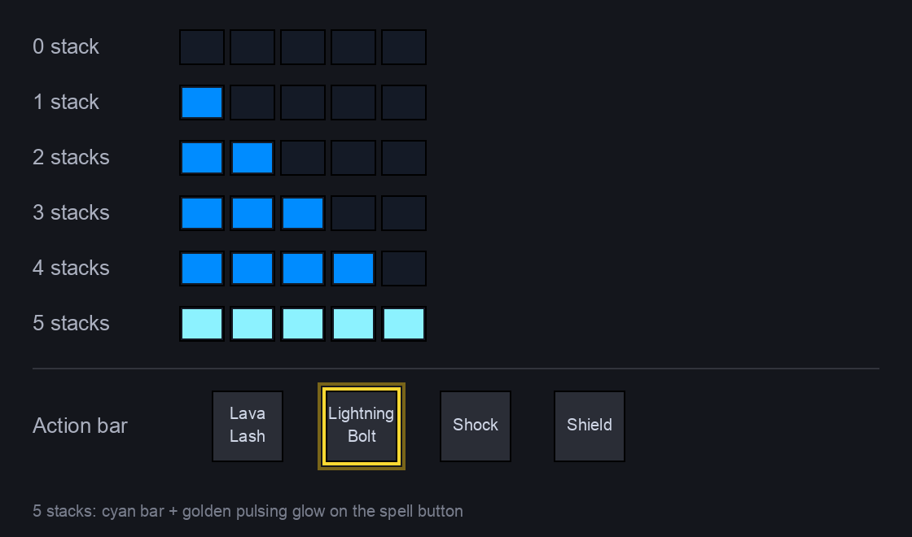

# MaelstromBar

A 5-square bar that tracks **Maelstrom Weapon** stacks for Enhancement Shamans, Retail-style. Built for the **World of Warcraft: Forever (Classic+)** client. Standalone: no libraries or other addons required.

Author: **Petitcorps**

## Preview

Default look: blue squares for 1 to 4 stacks, light cyan at 5 stacks, and a bright golden pulsing glow on the Lightning Bolt button when you reach 5. Every color is configurable in the options panel.

## Features

- 5 squares that fill up with your stacks, with a different color at 5 stacks.
- Shown with at least 1 stack or in combat, or always (option).
- Movable through the interface **Edit Mode** if your client has one, otherwise with `/mw move`.
- **Glow** on your Lightning Bolt action-bar button at 5 stacks (option).
- Options panel in the AddOns menu: colors, scale, glow, test.
- Works in every client language (the buff is detected by spell ID 408505, with a localized-name fallback).
- **Works in combat** on clients that hide player auras from addons ("secret values"): the stacks are read through Blizzard's Cooldown Manager (see below).

## In combat: the Cooldown Manager

On recent clients, addons can no longer read the player's buffs during combat. MaelstromBar gets around this by borrowing the stack count from the **Maelstrom Weapon icon of Blizzard's Cooldown Manager**, so that buff must stay in the Cooldown Manager's tracked buffs.

- On login, the addon enables the Cooldown Manager if needed and tries to add Maelstrom Weapon to the tracked buffs by itself.
- If the buff is still not tracked, the bar shows a **red warning** underneath it. Add Maelstrom Weapon to the tracked buffs in the Cooldown Manager settings, or type `/mw setup` to retry and see what failed.
- The action-bar glow at 5 stacks works in combat too: like the squares, it is driven directly by the hidden stack count.

## Installation

Copy the `MaelstromBar` folder into `World of Warcraft/_forever_/Interface/AddOns/`, then `/reload` or restart the game.
If the addon is flagged as out of date, tick "Load out of date AddOns".

## Options

**Options > AddOns > MaelstromBar**, or `/mw options`.

## Slash commands

| Command | Effect |
|---|---|
| `/mw options` | Open the options panel |
| `/mw move` / `/mw lock` | Unlock / lock the bar so you can move it |
| `/mw always` | Always show the bar, on/off |
| `/mw color <r> <g> <b>` | Color of stacks 1 to 4 (values from 0 to 1) |
| `/mw color full <r> <g> <b>` | Color at 5 stacks |
| `/mw scale <0.5-3>` | Bar scale |
| `/mw glow` | Action-bar glow on/off |
| `/mw glowspell <name or ID>` | Spell to highlight (empty = Lightning Bolt) |
| `/mw glowframe <FrameName>` | Add or remove a frame to highlight; no argument: list; `clear`: remove all |
| `/mw test <0-5>` | Simulate stacks to check the display (`0` = stop) |
| `/mw aura <name>` | Buff name to track, if detection by ID fails |
| `/mw reset` | Reset the position |
| `/mw setup` | Check the Cooldown Manager and try to track Maelstrom Weapon in it (out of combat) |
| `/mw debug` | List active buffs (name, stacks, ID) |
## Troubleshooting

- **The bar stays empty in combat:** make sure Maelstrom Weapon is in the Cooldown Manager's tracked buffs (a red warning under the bar tells you when it is not), then type `/mw setup`.
- **The bar stays empty out of combat too:** with stacks active, type `/mw debug` and check that the buff shows up. If it has another name, use `/mw aura <exact name>`.
- **No glow:** make sure the spell is on an action bar, then try `/mw test 5`. For a button from another addon, use `/mw glowframe <FrameName>` (find the name with `/fstack`).
- **The addon does not show up:** wrong folder, or "Load out of date AddOns" is not ticked.

## License

Open source, released under the [MIT License](LICENSE). Copyright (c) 2026 Petitcorps.
